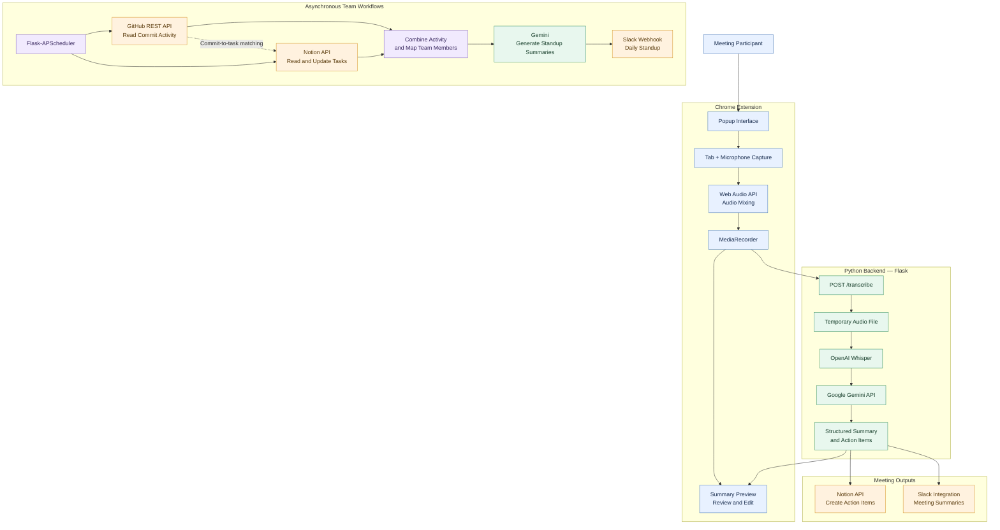

# 🕒 MinuteMate

### From meeting conversations to actionable team workflows.

MinuteMate is an AI-powered meeting assistant that helps teams turn discussions into structured meeting notes, actionable tasks, and async progress updates.

It combines a Chrome Extension (Manifest V3), OpenAI Whisper for speech-to-text, Google Gemini for meeting analysis, and integrations with GitHub, Notion, and Slack. Beyond meeting summarization, it connects development activity and task progress to automated standup reporting.

**The idea:** A useful meeting assistant should do more than summarize a conversation. It should help turn what was discussed into work that teams can track and act on.

---

## 📌 Table of Contents

- [The Problem](#-the-problem)
- [Key Features](#-key-features)
- [Architecture](#️-architecture)
- [How It Works](#-how-it-works)
- [Technology Stack](#️-technology-stack)
- [Project Structure](#-project-structure)
- [Getting Started](#-getting-started)
- [Configuration](#-configuration)
- [Current Limitations](#-current-limitations)
- [Security](#-security)

---

## 💡 The Problem

Distributed teams often lose important context between meetings, documentation, and development tools.

- **Lost decisions:** Important discussion points and action items can disappear in lengthy conversations.
- **Manual follow-ups:** Turning notes into tasks and communicating outcomes takes additional effort.
- **Fragmented workflows:** Meeting notes, task trackers, code changes, and team updates live in different tools.
- **Meeting fatigue:** Recurring status meetings can interrupt focused work when progress is already available in existing systems.

MinuteMate explores a connected workflow that captures meeting audio, extracts useful information, creates trackable Notion tasks, and brings development activity into async team updates.

---

## 🚀 Key Features

### 🎙️ Dual-Channel Audio Capture
Capture browser-tab audio and microphone input through a Chrome Extension using `chrome.tabCapture`, `getUserMedia`, the Web Audio API, and `MediaRecorder`.

### 📝 Speech-to-Text Transcription
Process recorded audio using OpenAI Whisper and convert conversations into text for downstream analysis.

### 🤖 AI-Powered Meeting Analysis
Use Google Gemini to generate structured meeting summaries and extract action items, including task descriptions and assignees where available.

### ✅ Notion Task Creation
Convert extracted action items into structured Notion database entries with task information, assignees, statuses, and due dates.

### 📣 Slack Notifications
Deliver meeting summaries and team updates through Slack integrations. The interface also supports reviewing and editing generated summaries before posting them.

### 🔄 GitHub Activity Monitoring
Poll GitHub repository commits and compare commit messages against existing Notion tasks. Matching tasks can be marked as completed in Notion.

### 📊 Automated Async Standups
Combine GitHub commit activity and Notion task information, generate per-user progress summaries with Gemini, and send consolidated standup updates to Slack.

---

## 🏗️ Architecture

The diagram below represents the main processing paths visible in the current implementation.



### Architecture principles

- **Separation of responsibilities:** Browser-side audio capture is separated from server-side transcription and AI analysis.
- **Tool integration:** Model-generated action items connect meeting insights to Notion, while GitHub and Notion activity support asynchronous progress reporting.
- **Scheduled processing:** Background jobs coordinate commit monitoring and daily standup generation.
- **Human review:** The extension provides a summary preview and editing interface before a user posts the reviewed summary.

The diagram is a logical view of the repository, not a claim that every component is independently deployed or production-hardened.

---

## 🔄 How It Works

### Workflow 1 — Meeting to Action Items

1. **Capture:** The Chrome Extension records browser-tab audio and microphone input.
2. **Upload:** The recorded audio is sent to the local Flask backend.
3. **Transcribe:** Whisper converts the audio into a text transcript.
4. **Analyse:** Gemini generates a meeting summary and structured action items.
5. **Organise:** Extracted action items are processed into Notion database entries.
6. **Communicate:** The workflow can send meeting summaries to Slack, while the extension displays the generated summary for review.

### Workflow 2 — Development Activity to Async Standup

1. **Collect:** Scheduled jobs retrieve GitHub commit information and existing Notion tasks.
2. **Correlate:** Commit messages are compared with task descriptions to identify potential completions.
3. **Update:** Matching Notion tasks can be marked as completed.
4. **Summarise:** Activity is grouped by mapped team member, and Gemini generates a structured progress update.
5. **Deliver:** A consolidated report is sent to Slack through a configured webhook.

---

## 🛠️ Technology Stack

| Component | Technologies |
|---|---|
| Browser Extension | Chrome Extension Manifest V3, JavaScript, HTML, CSS |
| Audio Processing | Chrome Tab Capture API, `getUserMedia`, Web Audio API, `MediaRecorder` |
| Backend | Python, Flask, Flask-CORS |
| Speech Recognition | OpenAI Whisper, FFmpeg |
| Generative AI | Google Gemini API |
| Task Management | Notion API, `notion-client` |
| Development Activity | GitHub REST API |
| Team Communication | Slack SDK, Slack Webhooks |
| Scheduling | Flask-APScheduler |
| Configuration | `python-dotenv`, environment variables |
| Workflow Automation | GitHub Actions workflow files |

---

## 📂 Project Structure

```text
MinuteMate/
├── .github/
│   └── workflows/
│       └── main.yml
├── backend/
│   ├── dailysync/
│   │   ├── flask_app.py
│   │   ├── main.py
│   │   ├── github_integration.py
│   │   ├── notion_integration.py
│   │   ├── create_notiondb.py
│   │   ├── summarize_llm.py
│   │   ├── slack_sender.py
│   │   ├── check_models.py
│   │   ├── fix_issues.py
│   │   ├── setup_env.py
│   │   └── user_mapping.json
│   └── whisper_api/
│       ├── app.py
│       └── meeting_summary_info.json
├── extension/
│   ├── manifest.json
│   ├── background.js
│   ├── popup.html
│   ├── popup.js
│   ├── offscreen.html
│   ├── offscreen.js
│   ├── styles.css
│   └── LOGO.png
├── web_app/
│   ├── index.html
│   └── app.js
├── requirements.txt
├── .gitignore
└── .env.example
```

`.env.example` is a configuration template to maintain in the repository; a real `.env` file should remain local and untracked. The tree above omits generated files and local configuration.

---

## ⚡ Getting Started

### Prerequisites

- Python 3.9 or later, compatible with the installed dependencies
- Google Chrome
- FFmpeg installed and accessible from your system `PATH`
- API credentials for the integrations you intend to use

### 1. Clone the Repository

```bash
git clone https://github.com/sovanghoshh/MinuteMate.git
cd MinuteMate
```

### 2. Create a Virtual Environment

**Windows — PowerShell**

```powershell
python -m venv .venv
.\.venv\Scripts\Activate.ps1
```

**macOS / Linux**

```bash
python3 -m venv .venv
source .venv/bin/activate
```

### 3. Install Dependencies

Run this command from the repository root:

```bash
python -m pip install -r requirements.txt
```

### 4. Configure Environment Variables

Create a local `.env` file using `.env.example` as a template. Add the required API credentials and configuration values described below.

### 5. Start the Backend

Run from the repository root:

```bash
python backend/dailysync/flask_app.py
```

The backend is configured to listen on port `5000`. Its health endpoint is available at:

```text
http://127.0.0.1:5000/health
```

Keep the backend running while using the extension.

### 6. Load the Chrome Extension

1. Open `chrome://extensions/` in Chrome.
2. Enable **Developer mode**.
3. Select **Load unpacked**.
4. Choose the repository's `extension/` directory.
5. Open the extension, grant the required audio permissions, and test it against the running local backend.

The extension currently calls a local backend URL. A deployed backend requires the relevant endpoint configuration and deployment setup to be updated.

---

## 🔐 Configuration

The backend reads configuration from environment variables. The following names are used by the current code:

| Variable | Purpose |
|---|---|
| `GEMINI_API_KEY` | Google Gemini API access |
| `TOKEN_GITHUB` | GitHub API authentication |
| `REPO_OWNER` | GitHub repository owner |
| `REPO_NAME` | GitHub repository name |
| `NOTION_TOKEN` | Notion integration authentication |
| `PARENT_PAGE_ID` | Parent page for Notion database creation |
| `DATABASE_ID` | Notion task database |
| `GITHUB_REPO_URL` | Optional GitHub repository link used in task metadata |
| `SLACK_BOT_TOKEN` | Slack bot authentication |
| `SLACK_CHANNEL_ID` | Slack channel configuration |
| `SLACK_WEBHOOK_URL` | Slack webhook for standup delivery |

Some features require only a subset of these variables. Configure the relevant Notion database properties and integration permissions before running task creation or status updates.

Never put real credentials in the README, source code, screenshots, or committed configuration files.

---

## ⚠️ Current Limitations

MinuteMate is an evolving project, and its current implementation has some practical constraints:

- The extension is configured to communicate with a local backend by default.
- GitHub commit-to-task matching relies on commit-message text, so a match should not be treated as definitive proof that a task is complete.
- AI-generated summaries and action items should be reviewed for missing context, incorrect assignments, or unsupported conclusions.
- Scheduled jobs and external integrations depend on valid credentials, API permissions, service availability, and correct configuration.
- The repository contains separate Flask entry points for meeting processing. Confirm which entry point you intend to use and keep their configuration and behavior consistent.

These constraints are important when evaluating reliability for broader team use.

---

## 🔒 Security

- Keep `.env` files and real API credentials out of version control.
- Use least-privilege credentials for GitHub, Notion, and Slack.
- Avoid logging access tokens or sensitive meeting content.
- Review AI-generated actions before allowing them to modify important records.
- Validate task fields and handle external API failures before relying on workflow automation.

---

## 🎯 Project Goal

MinuteMate explores how AI can connect conversations, knowledge, and execution.

The long-term direction is to make asynchronous collaboration more effective by combining meeting context with work activity, while keeping outputs reviewable and external actions dependable.

**Built with Python, JavaScript, Whisper, Gemini, and productivity-tool APIs.**
